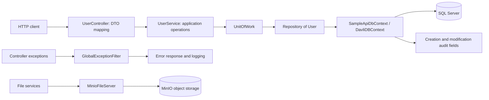

# Davli 

Davli is a framework based on ASP.Net Core for web projects with requirements such as high-performance, scalability, reliability, extensibility. Davli uses the update and famous technologies in ASP.Net Core. Davli is the summary of different frameworks. The following is a list of technologies that are used in Davli. I'm going to regularly update the document in the next commits.

### Technologies:

- .Net5
- EF Core
- Autofac
- Swagger
- MinIO
- SQL Server


### Todo:

- Standard Repository Implementation example.

- Minio documentation.

- Settings documentation.

- Filter documentation.

- Add Automapper.

- Add Docker and cocker-compose.yml.

- Add Serilog, Elasticsearch, Kibana, Fluentd, Nginx.

  

## Davli engineering case study

This case study describes the original .NET 5 source and its design tradeoffs. The improvements discussed below are proposals; no implementation changes are included in this documentation update.

### Architecture



Storage is a separate framework capability; the user CRUD example does not demonstrate file uploads.

### Source walkthrough

| Capability | Evidence | Decision to discuss |
| --- | --- | --- |
| Layered API | [UserController](Davli.Framework.SampleApi/Controllers/UserController.cs), [UserService](Davli.Framework.SampleApi/Services/Impl/UserService.cs) | DTO mapping separates transport from application operations at the cost of extra mapping code. |
| Data access | [Repository](Davli.Framework/Orm/Models/Impl/Repository.cs), [UnitOfWork](Davli.Framework/Orm/Models/Impl/UnitOfWork.cs) | A common vocabulary wraps EF Core, but `IQueryable` exposes provider details. |
| Auditing | [DavliDBContext](Davli.Framework/Orm/EntityFrameworkCode/DavliDBContext.cs) | Save-boundary auditing centralizes behavior; identity trust and overload coverage need scrutiny. |
| DI conventions | [DavliDIModule](Davli.Framework/DI/DavliDIModule.cs) | Marker interfaces reduce registration repetition; lifetime correctness needs resolution tests. |
| Errors | [GlobalExceptionFilter](Davli.Framework/AspNet/Mvc/ExceptionHandling/GlobalExceptionFilter.cs) | A common envelope and status mapping aid clients; production redaction and trace IDs need improvement. |
| Storage | [MinioFileServer](Davli.Framework/Services/Impl/MinioFileServer.cs) | An adapter keeps vendor operations behind a contract; stream behavior requires integration coverage. |
| Configuration | [OptionService](Davli.Framework/Options/OptionService.cs) | Reflection reduces binding boilerplate; static mutable state makes repeated hosts harder to isolate. |

Meaningful integration tests should verify CRUD persistence, missing-user responses, audit fields, dependency lifetimes, and safe production errors. A future CI workflow should build the solution, run those tests, and verify a reproducible demo from a clean checkout.

### Suggested interview walkthrough

1. Explain the framework/sample boundary using the diagram.
2. Trace a create-user request through the controller, service, repository, and save operation.
3. Explain missing-user responses and the proposed integration tests.
4. Discuss one concrete limitation, such as header-derived audit identity or DI lifetimes, and how a regression test would expose it.
5. Once a reproducible demo is implemented, demonstrate creating, reading, updating, and deleting a user through Swagger with synthetic data.

The source supports discussing these design choices. It does not establish commercial usage, performance improvements, production reliability, or a passing automated suite in the restored repository.

## Integrate with a project

Davli is designed for ASP.Net Web API applications and there is a sample project that you can debug Davli. To integrate it with your project you should do some changes in `Program.cs` and `Sturtup.cs`. At the first step, you should register `AutofacServiceProviderFactory` by using it as the following in the `Program.cs` file to integrate `Autofac` with project. 

```c#
public static IHostBuilder CreateHostBuilder(string[] args) =>
            Host.CreateDefaultBuilder(args)
             .UseServiceProviderFactory(new AutofacServiceProviderFactory())
                .ConfigureWebHostDefaults(webBuilder =>
                {
                    webBuilder.UseStartup<Startup>();
                });
```

After that, add the following function to Sturtup.cs to define dependency injection roles. In Autofac section we will explain details.

```C#
public void ConfigureContainer(ContainerBuilder builder)
        {
            builder.RegisterModule(new DIModule());
            builder.RegisterModule(new DavliDIModule());
        }
```

At the second step, register Davli's services by `AddDavliServices` in `ConfigureServices` function at `Sturtup.cs` file.

```c#
services.AddDavliServices(Configuration);
```

Also, to use SQL SERVER database add the following code to `ConfigureServices`  function after registering Davli's services. `SampleApiDbContext` is your `DbContext` and you will define your poco models there. In the EF Core section, I will explain more details.

```C#
services.AddDbContext<DavliDBContext, SampleApiDbContext>(opt => opt.UseSqlServer(Configuration.GetConnectionString("Davli")),
                ServiceLifetime.Transient);
```

Your ConfigureServices will lookl like the following code.

```C#
public void ConfigureServices(IServiceCollection services)
        {
            services.AddDavliServices(Configuration);
            services.AddDbContext<DavliDBContext, SampleApiDbContext>(opt => opt.UseSqlServer(Configuration.GetConnectionString("Davli")),
                ServiceLifetime.Transient); 
        }
```

Finally, add UseDavliApplication to your Configure function in Startup.cs file. your Configure function will look like the following code:

```c#
public void Configure(IApplicationBuilder app, IWebHostEnvironment env)
    {
        app.UseDavliApplication();

        app.UseRouting();
        app.UseEndpoints(endpoints =>
        {
            endpoints.MapControllers();
        });
    }
```


## EF Core

[Entity Framework (EF)](https://docs.microsoft.com/en-us/ef/core/) Core is a lightweight, extensible, [open source](https://github.com/dotnet/efcore) and cross-platform version of the popular Entity Framework data access technology. 

I used it in combination with a generic repository pattern and without it (I will explain their details in the generic repository pattern section and the standard repository section). To use it, add the following code to your `ConfigureServices` function in `Startup.cs`. `SampleApiDbContext` is your `DbContext` and you should define your poco models there.

```C#
public void ConfigureServices(IServiceCollection services)
        {
            services.AddDavliServices(Configuration);
            services.AddDbContext<DavliDBContext, SampleApiDbContext>(opt => opt.UseSqlServer(Configuration.GetConnectionString("Davli")),ServiceLifetime.Transient); 
        }
```


The following code is implementation of  `SampleApiDbContext` that has a User object (User is a poco object).

```c#
public class SampleApiDbContext: DavliDBContext
{
    public SampleApiDbContext(DbContextOptions<SampleApiDbContext> options, RequestContext requestContext) : base(options, requestContext)
    {
        RequestContext = requestContext;
    }
    public DbSet<User> Users { get; set; }
}
```


sAlso, to use the generic repository, all poco models should derive the `DavliEntity<TPrimaryKey>` class. `DavliEntity<TPrimaryKey>` gets a type as the primary key and the implementation of it is as follows. All properties in `DavliEntity<TPrimaryKey>` automatically update by Davli. For more details and soft delete check the `DavliDBContext` class

```c#
public class DavliEntity<TPrimaryKey> : IDavliEntity, ICreationConcept, IModificationConcept
    {
        public TPrimaryKey Id { get; set; } //Primary key
        public DateTime? LastModificationTime { get; set; } //Indicates the last time the change was applied
        public long? LastModifierUserId { get; set; } //Indicates who was the last person to change the data 
        public DateTime CreationTime { get; set; } //Indicates the time the entity was created
        public long? CreatorUserId { get; set; } //Indicates who created the data
    }
```

The implementation of the User class is as follows. The type of its primary key is `long` and its name is `Id`.

```c#
public class User : DavliEntity<long>
    {
        [MaxLength(100)]
        public string Name { get; set; }
    }
```


#### Generic Repository Pattern

You can debug this section by calling `UserController` actions. Also, the `UserService` class implementation is based on the generic repository pattern. After implementation of poco models, to use the generic repository pattern you need to inject `IUnitOfWork` in your class and manipulate your entities by `_unitOfWork.GenericRepository<DavliEntity<TPrimaryKey>>()` and its methods. `GenericRepository<DavliEntity<TPrimaryKey>>()` returns `IRepository<DavliEntity<TPrimaryKey>>` and it has common Linq .Expression methods. For more information about it check `Repository.cs` class (to prevent access to data query from business layer replace `IQueryable` by `Enumerable` in `Where` function).  To save changes use `_unitOfWork.SaveAsync()`. A simple example of it is as follows.

```c#
public class UserService : IUserService, ITransientLifetime
{
    private readonly IUnitOfWork _unitOfWork;
    
	public UserService(IUnitOfWork unitOfWork)
	{
		_unitOfWork = unitOfWork;
	}

	public async Task<UserModel> AddNewUserAsync(RegisterUserModel registerUserModel)
	{
		User user = new User { Name = registerUserModel.Name };
		_unitOfWork.GenericRepository<User>().Add(user);
		await _unitOfWork.SaveAsync();
		return new UserModel { Id = user.Id, Name = user.Name };
	}
    
    public async Task DeleteUserAsync(long userId)
	{
		User user = await _unitOfWork.GenericRepository<User>().FirstOrDefaultAsync(x => x.Id == userId);
		if (user == null)
			throw new DavliExceptionNotFound("User not found.");
		await _unitOfWork.GenericRepository<User>().RemoveAsync(x => x.Id == userId);
		await _unitOfWork.SaveAsync();
	}
}
```


#### Standard Repository Implementation

//Todo: Implement a sample.


## Migrations

To add new models use the following code in command line.

```powershell
dotnet ef migrations add InitialModels --project Davli.Framework.SampleApi
```

if you got a error like the following message, update your EF tools by `dotnet tool update --global dotnet-ef`

> The Entity Framework tools version 'x.x.x' is older than that of the runtime 'y.y.y'. Update the tools for the latest features and bug fixes.
> The name 'InitialModels' is used by an existing migration.

```powershell
dotnet tool update --global dotnet-ef
```

To update database use the following code.

```powershell
dotnet ef database update --project Davli.Framework.SampleApi
```


## Swagger

[Swagger](https://swagger.io/tools/swagger-ui/) is an Interface Description Language for describing RESTful APIs expressed using JSON. Swagger UI allows anyone — be it your development team or your end consumers — to visualize and interact with the API’s resources without having any of the implementation logic in place. It’s automatically generated from your OpenAPI (formerly known as Swagger) Specification, with the visual documentation making it easy for back end implementation and client side consumption. Swagger UI is embedded in Davli and just needs to add the following config to `appsetting.json`. To access Swagger UI use `{hostname}/swagger` address (you can change default `launchUrl` at your project `Properties/launchSettings.json` file).  

```json
{
  "SwaggerOption": {
    "JsonRoute": "swagger/{documentName}/swagger.json",
    "Description": "Sample Api",
    "Name": "nameofApi",
    "UIEndpoint": "v1/swagger.json",
    "Title": "Title of Api",
    "Version": "Version of Api"
  }
}
```


## Autofac

[Autofac](https://autofac.org/) is an addictive [Inversion of Control container](http://martinfowler.com/articles/injection.html) for .NET Core, ASP.NET Core. It manages the dependencies between classes so that **applications stay easy to change as they grow** in size and complexity. To integrate it with your project you should do some changes in `Program.cs` and `Sturtup.cs`. At the first step, you should register `AutofacServiceProviderFactory` by using it as the following in the `Program.cs` file to integrate `Autofac` with project. 

```c#
public static IHostBuilder CreateHostBuilder(string[] args) =>
            Host.CreateDefaultBuilder(args)
             .UseServiceProviderFactory(new AutofacServiceProviderFactory())
                .ConfigureWebHostDefaults(webBuilder =>
                {
                    webBuilder.UseStartup<Startup>();
                });
```

After that, add the following function to `Startup.cs` to define dependency injection roles. To register Davli class you have to register `DavliDIModule` and for the current project (for example `Sample.Api`) you have to register `DIModule`.  `DIModule` and `DavliDIModule` have the same content that you can change and use just one of them.

```C#
public void ConfigureContainer(ContainerBuilder builder)
        {
            builder.RegisterModule(new DIModule());
            builder.RegisterModule(new DavliDIModule());
        }
```

Resolving services has the following life times and for each of them we have defines an specific Interface.

- **Single Instance**: Single Instance is based on singleton pattern and create an instance of class and share same instance between all dependencies. We use `ISingletonLifetime` to sign classes that are needed to be singleton.

  > This is also known as ‘singleton.’ Using single **instance** scope, **one instance is returned from all \**request\**s in the root and all nested scopes**.

- **Instance Per Request**:  InstancePerRequest resolves dependencies per request. It means during processing a request if a service is injected and within inner dependencies, again the service is injected, both services refer to the same instance. We use `IScopedLifetime` to sign classes that are needed to be InstancePerRequest.

  > Some application types naturally lend themselves to “**request**” type semantics, for example ASP.NET [web forms](https://autofac.readthedocs.io/en/latest/integration/webforms.html) and [MVC](https://autofac.readthedocs.io/en/latest/integration/mvc.html) applications. In these application types, it’s helpful to have the ability to have a sort of “singleton **per** request.”

- **Instance Per Dependency**: InstancePerDependency create a new instance per injection. We use `ITransientLifetime` to sign classes that are needed to be InstancePerRequest.

  > Also called ‘transient’ or ‘factory’ in other containers. Using **per**-dependency scope, **a unique \**instance\** will be returned from each \**request\** for a service.**


The following code indicates the `UserService` is implementation of `IUserService` and is signed with `ITransientLifetime` interface. When `IUserService` is injected to another class, Autofac due to `ITransientLifetime` creates a new instance of `UserService`. If instead of `ITransientLifetime`, `UserService` had been signed with `ISingletonLifetime`, the existing instance was injected (just once create a new instance).

```c#
public class UserService : IUserService, ITransientLifetime
{
	//Implementation.
}
```

```C#
public class UserController : DavliControllerBase
 {
		private readonly IUserService _userService;
    
        public UserController(IUserService userService)
        {
            _userService = userService;
        }

}
```


`DavliDIModule` and `DIModule` are classes we have used to define `ITransientLifetime`, `IScopedLifetime`, and `ISingletonLifetime` behavior. Both of them are derived from `Autofac.Module` and override `Load` function. ThisAssembly says to Autofac to search current assembly and impose your role on classes that are derived from `ITransientLifetime`, `IScopedLifetime`, and `ISingletonLifetime`. DavliDIModule exists in the DavliFramework project and only registers roles for the DavliFramework project's classes. Also, DIModule exists in the current project (Sample.Api) and registers roles there.

```c#
public class DavliDIModule : Module
{
    protected override void Load(ContainerBuilder builder)
    {
        builder.RegisterAssemblyTypes(ThisAssembly)
            .Where(x => x.IsAssignableTo<ITransientLifetime>()).AsSelf().AsImplementedInterfaces()
            .InstancePerDependency();

        builder.RegisterAssemblyTypes(ThisAssembly)
            .Where(x => x.IsAssignableTo<IScopedLifetime>()).AsSelf().AsImplementedInterfaces()
            .InstancePerRequest();

        builder.RegisterAssemblyTypes(ThisAssembly)
            .Where(x => x.IsAssignableTo<ISingletonLifetime>()).AsSelf().AsImplementedInterfaces()
            .SingleInstance();
    }
}
```


Also, instead of registering both DavliDIModule and DIModule, you can ignore DavliDIModule and change DIModule as below. The following code says to Autofac search all *.dll in the build directory and imposes your role on classes that are derived from `ITransientLifetime`, `IScopedLifetime`, and `ISingletonLifetime` (not recommended).

```c#
public class DIModule : Module
{
    protected override void Load(ContainerBuilder builder)
    {
		var assemblies = Directory.EnumerateFiles(AppDomain.CurrentDomain.BaseDirectory, "*.dll", SearchOption.TopDirectoryOnly)
               .Select(Assembly.LoadFrom);

		builder.RegisterAssemblyTypes(assemblies.ToArray())
			.Where(x => x.IsAssignableTo<ITransientLifetime>()).AsSelf().AsImplementedInterfaces().InstancePerDependency();

		builder.RegisterAssemblyTypes(assemblies.ToArray())
			.Where(x => x.IsAssignableTo<IScopedLifetime>()).AsSelf().AsImplementedInterfaces().InstancePerRequest();

		builder.RegisterAssemblyTypes(assemblies.ToArray())
			.Where(x => x.IsAssignableTo<ISingletonLifetime>()).AsSelf().AsImplementedInterfaces().SingleInstance();
    }

}
```

You can use `ContainerBuilder` in `Startup.ConfigureContainer` to register new roles and types. Also, you can use ASP.NET Core Ioc in `Startup.ConfigureServices` function.

## Exceptions

When an exception occurs in the system the action result will be such as the following object and response HttpStatusCode will be 4xx or 5xx. HttopStatusCode in the range of 4xx shows the exception is because of user behavior (client-side) and 5xx shows it has occurred because of system defects (server-side). In the SampleApi project, there is an `ExceptionController` that you can use to throw an exception and see the result.

```json
{
  "__unauthorizedRequest": true,
  "__wrapped": true,
  "__traceId": "",
  "error": {
    "errorCode": "USER_NOT_FOUND",
    "message": "User not found.",
    "details": "",
    "source": ""
  }
}
```

 The above response had HttpStatusCode 404 that shows the not found exception has occured. Depend on the application is running on production or other environments, the `message`, `details`, and `source` can have more details about exceptions. 

- **__unauthorizedReques**t: shows the request is authorized or not. In the above example, the request is not authorized.
- **__wrapped**: shows the result is wrapped or not. Now, by default, all exceptions are wrapped.
- **__traceId**: TraceId will use to track a request over other systems and services. It is not implemented.
- **error.errorCode**: ErrorCode shows the exception reason. When a developer throws a `DavliException`, he/she will fill this field.
- **error.Message**: Message shows the exception reason.  
- **error.Details**: Details shows details of exceptions such as stack trace and inner exception details. It is always empty in production environment.
- **error.Source**: The source shows the service that has raised the exception. If you use microservice architecture, It would show the name of the service and its version. The following config is needed in `appsetting. json` (It is always empty in production).


```json
{
  "ServiceInfo": {
    "Name": "Service Name",
    "Description": "Service Description",
    "Version": "1.0"
  }
}
```


Davli has its Exception that is derived from Exception. Also, there are other exceptions that are derived from `DavliException`. We suggest to use `DavliException` and you can define new exceptions by driving `DavliException`. If you have defined a new exception that is derived from `DavliException`, check `GlobalExceptionFilter.cs` class for more details about exceptions.

```c#
public class DavliException : Exception 

{
    /// <summary>
    /// Error code that indicates a summary of error by using some words or numbers.
    /// </summary>
​	public string ErrorCode { get; protected set; }
    
    /// <summary>
    /// Technical-details are not allowed to be shown to the user.
    /// Just log them or use them internally by software-technicians.
    /// </summary>
    public string TechnicalMessage { get; protected set; }
}
```


- **DavliException**: This exception use generally and its HttpStatusCode will be 500.

- **DavliExceptionNotFound**: This exception use to show NotFoundException and HttpStatusCode will be 404.

- **DavliExceptionInvalidParameter**: This exception use to show InvalidParameter and HttpStatusCode will be 422.

- **DavliBusinessException**: This exception use to show BusinessException and HttpStatusCode will be 400 (recommended for exceptions that should be thrown because of a business defect).

- **DavliExceptionBadRequest**: This exception use to show BadRequestand HttpStatusCode will be 400.

- **DavliExceptionExternalService**: This exception shows during calling other API an exception has occurred and its HttpStatusCode can be set manually.

- **Exception**:  This exception use generally and its HttpStatusCode will be 500.

  


