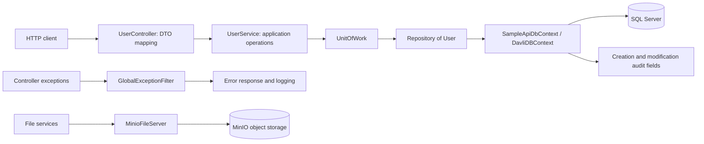

# Davli engineering case study

This case study describes the original source. Proposed tests and improvements are documented separately; no implementation changes are included in this update.

## Architecture

Storage is a separate framework capability; the user CRUD example does not demonstrate file uploads.

## Source walkthrough

| Capability | Evidence | Decision to discuss |
| --- | --- | --- |
| Layered API | [UserController](../Davli.Framework.SampleApi/Controllers/UserController.cs), [UserService](../Davli.Framework.SampleApi/Services/Impl/UserService.cs) | DTO mapping separates transport from application operations at the cost of extra mapping code. |
| Data access | [Repository](../Davli.Framework/Orm/Models/Impl/Repository.cs), [UnitOfWork](../Davli.Framework/Orm/Models/Impl/UnitOfWork.cs) | A common vocabulary wraps EF Core, but `IQueryable` exposes provider details. |
| Auditing | [DavliDBContext](../Davli.Framework/Orm/EntityFrameworkCode/DavliDBContext.cs) | Save-boundary auditing centralizes behavior; identity trust and overload coverage need scrutiny. |
| DI conventions | [DavliDIModule](../Davli.Framework/DI/DavliDIModule.cs) | Marker interfaces reduce registration repetition; lifetime correctness needs resolution tests. |
| Errors | [GlobalExceptionFilter](../Davli.Framework/AspNet/Mvc/ExceptionHandling/GlobalExceptionFilter.cs) | A common envelope and status mapping aid clients; production redaction and trace IDs need improvement. |
| Storage | [MinioFileServer](../Davli.Framework/Services/Impl/MinioFileServer.cs) | An adapter keeps vendor operations behind a contract; stream behavior requires integration coverage. |
| Configuration | [OptionService](../Davli.Framework/Options/OptionService.cs) | Reflection reduces binding boilerplate; static mutable state makes repeated hosts harder to isolate. |

See [architecture decisions and proposed improvements](ARCHITECTURE_DECISIONS.md) for the rationale and compatibility considerations, and [the tests and CI plan](TESTS_AND_CI.md) for the evidence needed to verify changes.

## Suggested interview walkthrough

1. Explain the framework/sample boundary using the diagram.
2. Trace a create-user request through the controller, service, repository, and save operation.
3. Explain missing-user responses and the proposed integration tests.
4. Discuss one concrete limitation, such as header-derived audit identity or DI lifetimes, and how a regression test would expose it.
5. Once a reproducible demo is implemented, show the [CRUD walkthrough](DEMO.md) with synthetic data.

The source supports discussing these design choices. It does not establish commercial usage, performance improvements, production reliability, or a passing automated suite in the restored repository.
